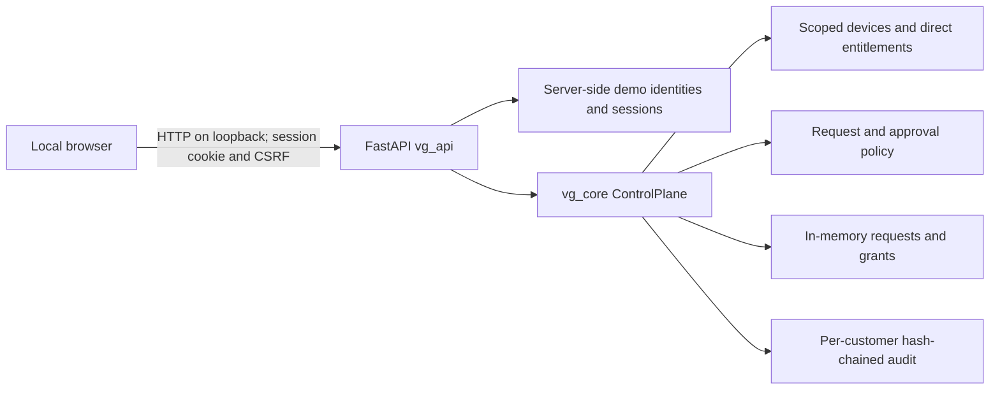
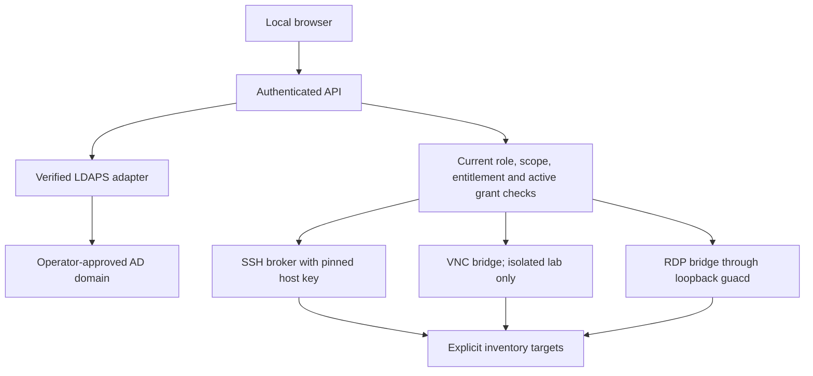
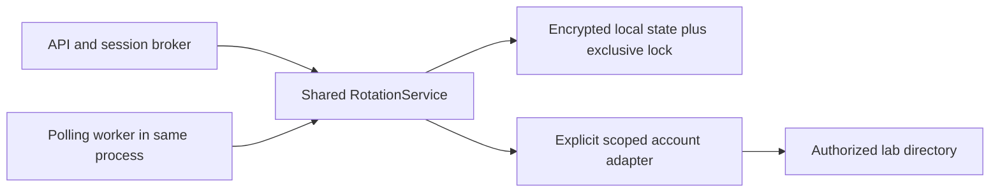

# Architecture and implementation boundaries

This describes the shipped Python prototype, not a proposed hosted service. OpenPrivileged is the public product name; `vg_core`, `vg_api`, selected `VAULTGATE_*` names and container identifiers are retained compatibility identifiers. Renaming those strings without inspecting consumers can break imports or runtime configuration.

## Default local control plane

There is one application process. Identity, organization, customer scope and selected role are resolved by trusted server state, not client-provided identity headers. The app factory denies authenticated operations without a configured trusted identity adapter. Local demo authentication is intentionally not production identity.

The core maintains devices, policies, requests, grants and audit events. Mutations are serialized in process. Requests enforce reason/ticket requirements, policy duration, independent review and configured approval quorum. Approval-based and explicitly time-bounded grants expire; standing direct-access grants have `expires_at: null` and no time-based expiry. Both can be revoked and remain subject to current authorization checks. Direct access is a separate explicit entitlement path, not an implicit administrator privilege. Scope/ownership checks apply server-side.

Expiry of disconnected grants is evaluated on reads/revocations or explicit `ControlPlane.expire()` calls. There is no durable general expiry scheduler. An active status alone does not prove a real device session exists.

## Optional directory and transport paths

Directory group mappings select application roles and assigned device IDs; group membership is not a substitute for a device's operating-system access controls. Optional provisioning and managed credentials have further explicit boundaries; see [AD integration](AD-INTEGRATION.md) and [managed accounts](AD-MANAGED-ACCOUNTS.md).

Targets and credentials come from operator-controlled configuration, not arbitrary browser parameters. SSH checks pinned host keys. RDP requires a certificate pin. Credentials stay server-side. Bridges recheck authorization during active connections, including a roughly one-second watchdog, and close on expiry, revocation, logout or changed authorization. Closing transport is not guaranteed termination of remote background jobs or withdrawal of operating-system privileges. VNC's lab-side leg is not encrypted.

## Optional combined rotation runtime

The combined runtime (`vg_api.rotation_app`) owns one shared rotation service/store for the broker and worker. The worker checks deadlines; restart does not intentionally reset the stored deadline. A lifetime file lock prevents a second local owner. Pending/uncertain resets are blocked for reconciliation rather than blindly repeated. Managed-account bindings include exact directory identity and scope, not just a mutable username.

Encrypted rotation state does **not** make ordinary control-plane state durable. Grants, login sessions and ordinary audit events remain in memory. The implementation is single-process, not horizontally scalable or highly available. Do not start another worker, cron reset job or replica against the same account/state.

## Source map

| Component | Source |
| --- | --- |
| Domain policy, approvals, grants and audit | `packages/vg_core/src/vg_core/domain.py` |
| Rotation state machine/worker | `packages/vg_core/src/vg_core/rotation.py` |
| API factory, demo seed and CLI | `packages/vg_api/src/vg_api/main.py` |
| Login, sessions and UI routes | `packages/vg_api/src/vg_api/demo_auth.py` |
| LDAPS and directory identity | `directory.py`, `directory_auth.py` in `vg_api` |
| Settings and optional provisioning | `directory_management.py`, `directory_provisioning.py` |
| Inventory and key-based SSH | `lab_access.py`, `ssh_sessions.py` |
| Desktop transport | `desktop_bridge.py`, `rdp_bridge.py` |
| Managed SSH and scoped AD rotation | `managed_ssh.py`, `rotation_managed_ad.py` |
| Encrypted local persistence | `rotation_store.py` |
| Combined API/worker lifecycle | `rotation_app.py` |

## Explicit non-guarantees

- No production OIDC/MFA, distributed transactional database or tenant RLS implementation.
- No production KMS-backed vault, HA, central key custody or automatic disaster recovery.
- No session screen/keystroke recording or guaranteed remote process cleanup.
- Hash chaining detects inconsistency in supplied events, not completeness, whole-history replacement or deletion without external trusted anchors. It is not WORM storage.
- Reference Terraform, platform containers and design documents are not evidence that a hosted platform exists or has been deployed.

Read [SECURITY.md](../SECURITY.md) before connecting any real isolated-lab system. Test safety boundaries with synthetic data first.
